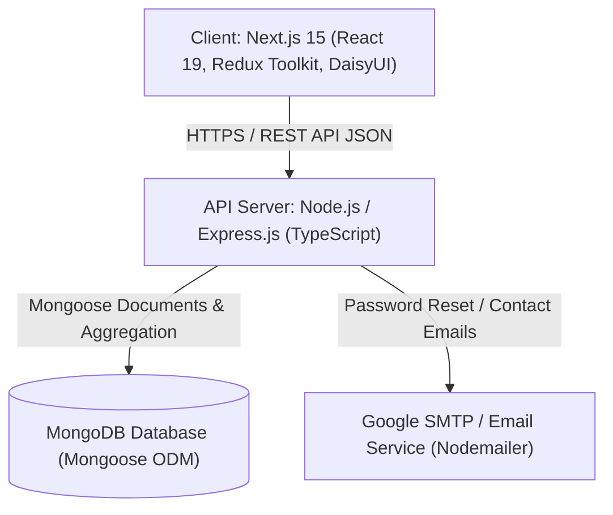
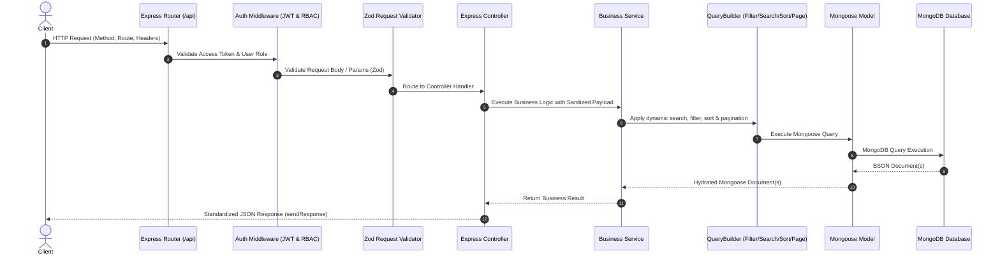
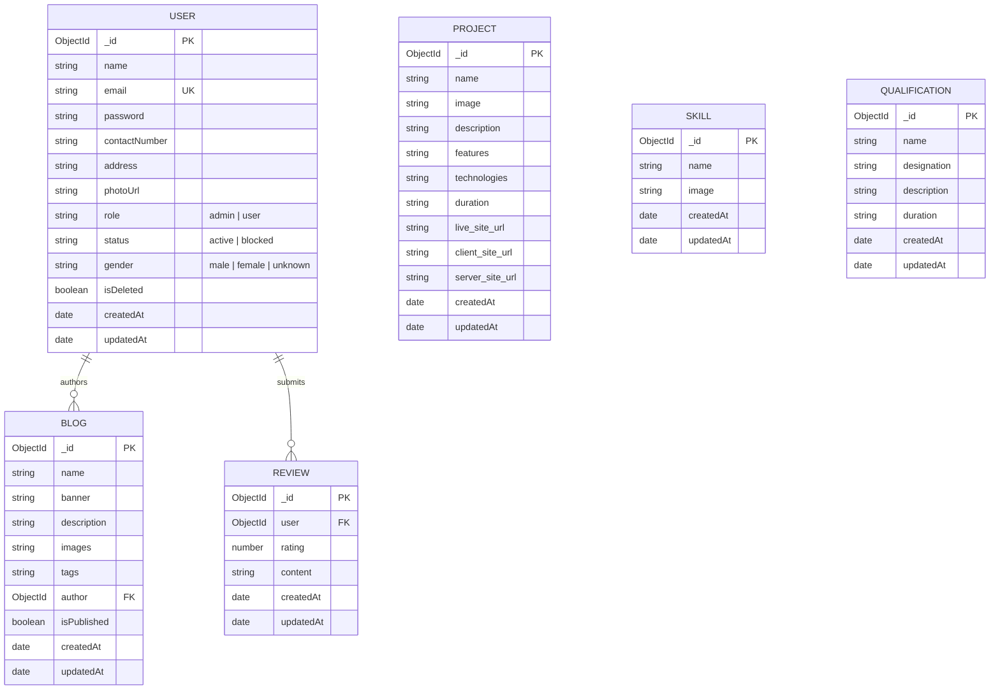

# Portfolio Platform - System Architecture & Engineering Blueprint

This document details the software architecture, component boundaries, data relationships, and design patterns governing the **Portfolio Platform**.

---

## 1. High-Level System Architecture

The Portfolio Platform is architected as a decoupled multi-tier web application consisting of a **Next.js 15** frontend (App Router, Tailwind CSS, DaisyUI, Redux Toolkit), an **Express.js (TypeScript)** REST API server, and a **MongoDB** document database accessed via **Mongoose ODM**.

---

## 2. Layered Server Architecture

The server adheres to a strict modular layered design where every incoming HTTP request flows sequentially through dedicated concerns:

### Layer Responsibilities:
1. **Router (`*.route.ts`)**: Defines endpoint paths and HTTP verbs (`GET`, `POST`, `PUT`, `PATCH`, `DELETE`). Injects middleware (`auth`, `validateRequest`).
2. **Middleware (`middleware/`)**:
   - `auth.ts`: Verifies incoming JWT Bearer tokens and checks role permissions (`admin`, `user`).
   - `validateRequest.ts`: Executes Zod schemas on `req.body`, `req.cookies`, or `req.params`.
   - `globalErrorHandler.ts`: Central error translation formatting all exceptions into a consistent schema.
3. **Controller (`*.controller.ts`)**: Extracts input arguments, calls corresponding service methods wrapped in `catchAsync`, and invokes `sendResponse()`.
4. **Service (`*.service.ts`)**: Encapsulates core business logic, query composition via `QueryBuilder`, data transformations, and model operations.
5. **Model (`*.model.ts`)**: Mongoose schema definitions with validation constraints, password hashing hooks (`pre('save')`), and static helper methods.

---

## 3. Data Model & Entity Relationships

---

## 4. Frontend State & Architecture

The Next.js 15 frontend leverages **Redux Toolkit** and **RTK Query** for efficient client-side caching and automated cache invalidation:

- **Centralized API (`baseApi.js`)**: Base RTK Query slice defining headers, authentication token attachment, and cache tags (`Auth`, `Users`, `Project`, `Blogs`, `Skills`, `Qualifications`, `Reviews`).
- **Feature APIs (`src/redux/features/*Api.js`)**: Module-specific endpoints (e.g., `getProjects`, `createProject`, `updateProject`, `deleteProject`) injected into `baseApi`.
- **Redux Persist**: Persists authentication credentials (user identity, access token) in client storage for seamless session continuity.
- **App Router Directory Structure**:
  - `(main)`: Public layout for portfolio visitors (Hero, Projects, Blogs, Contact).
  - `dashboard`: Protected backoffice layout for authorized administrative content curation.
  - `login` & `register`: Authentication portal.
