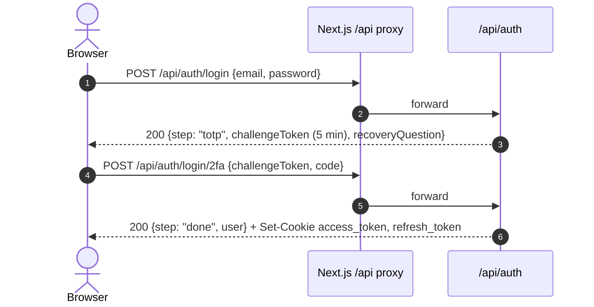

# Portfolio Platform - Authentication & Authorization Architecture

This document covers authentication, the session lifecycle, role-based access control (RBAC) and the security measures in the **Portfolio Platform**.

---

## 1. Overview

- **Passwords** are hashed with bcrypt (`BCRYPT_SALT_ROUNDS`, default 12) in a `pre('save')` hook that runs only when the password changes.
- The `password` and `securityAnswer` hashes, the authenticator secret and the backup-code hashes are `select: false` and stripped by the model's `toJSON`, so they never appear in API responses.
- **Sessions are httpOnly cookies, never readable by JavaScript.**
  - `access_token`: `JWT_ACCESS_EXPIRE_IN` (recommended `15m`), `Path=/`.
  - `refresh_token`: `JWT_REFRESH_EXPIRE_IN` (recommended `7d`), `Path=/api/auth`.
  - Both are `HttpOnly; SameSite=Strict`, plus `Secure` in production.
- **First-party cookies via proxy:** the browser calls `/api/*` on the Next.js site, and `client/next.config.mjs` rewrites those calls to the backend (`API_ORIGIN`). Cookies therefore belong to the site's own domain, and `SameSite=Strict` works across separate Vercel deployments.
- **Tokens carry a `typ` claim** (`access | refresh | challenge | reset`), so one kind cannot be replayed as another. For example, a reset link or a login challenge token is not a session.
- **Revocation:** every user has a `tokenVersion`, and each token embeds it as `tv`.
  - Logout, password change, password reset, turning two-factor on or off, and account recovery increment it.
  - Every request re-checks it, along with whether the user is deleted or blocked.
  - Roles are read from the database on every request, so a role change applies immediately.

## 2. Two-step sign in (authenticator app, backup codes, security question)

What the password step returns depends on the account:

| Account state | `step` | Second request |
| :--- | :--- | :--- |
| Authenticator enrolled | `totp` | `POST /login/2fa` with a 6-digit code or a backup code |
| No authenticator, security question set (legacy) | `challenge` | `POST /login/verify` with the answer |
| Neither | `done` | none; the dashboard shows a banner asking to turn two-factor on |

- No session cookie is set until every required step passes.
- **TOTP** (`modules/Auth/auth.totp.ts`) is RFC 6238 with the Google Authenticator defaults: SHA-1, 6 digits, 30 seconds, one step of clock drift either way. It is implemented on Node's `crypto` with no extra dependency and checked against the RFC test vectors.
  - The secret is stored AES-256-GCM encrypted (key derived from `TOTP_ENCRYPTION_KEY`), so a database leak alone does not expose it.
  - **Replay protection:** the last accepted time step is stored and a code for that step or an earlier one is refused. The update is atomic.
- **Backup codes:** ten `XXXXX-XXXXX` codes are shown once when two-factor is turned on. Only keyed SHA-256 hashes are stored, and a code is removed atomically when used. Generating a new set invalidates the old one.
- **Enrolment** (Dashboard → Security): `POST /2fa/setup` (current password) returns the secret and an `otpauth://` URL, which the dashboard draws as a QR code in the browser. The secret stays pending until `POST /2fa/enable` confirms a code. Turning two-factor on or off revokes every other session and reissues cookies for the current one.
- **Security question (optional):** the answer is normalised (trimmed, lower-cased, whitespace collapsed) and stored as a bcrypt hash.
  - Without an authenticator it is still the second login step, as before.
  - With an authenticator it is only a recovery path: `POST /login/recover` (after the password) signs in, turns two-factor off, revokes every other session and emails the owner. `/login/verify` is refused for these accounts, so the question can never stand in for a code.
  - A security answer is weaker than an authenticator. Leaving the question unset removes this recovery path; backup codes then are the only fallback.
- While two-factor is on, changing or removing the security question, generating backup codes and turning two-factor off all need the current password and a valid code.
- **Lockout:** 5 failed passwords, codes or answers lock the account for 15 minutes (HTTP 429). This holds even if the right value follows. Failures are counted with an atomic increment, including wrong codes on the signed-in settings endpoints.
- **No user enumeration:** an unknown email, a wrong password, or a deleted or blocked account all return the same `401 Invalid email or password`. Unknown emails still run a bcrypt compare, so response timing matches too.

## 3. Roles (RBAC)

- **`admin`**: dashboard access; management of portfolio content and contact messages; user management.
- **`user`**: can edit only their own profile.

Public sign-up is disabled. `POST /api/user/register` is admin-only and always creates role `user`. The sign-in page is `/dashboard/login`; `/login` and `/register` redirect there.

## 4. Endpoints

| Method | Endpoint | Access | Description |
| :--- | :--- | :--- | :--- |
| `POST` | `/api/auth/login` | Public (rate limited) | Step 1: password. Returns `totp`, `challenge` or a session (`done`) |
| `POST` | `/api/auth/login/2fa` | Public (rate limited) | Step 2: authenticator or backup code, then sets cookies |
| `POST` | `/api/auth/login/verify` | Public (rate limited) | Step 2 without an authenticator: security answer, then sets cookies |
| `POST` | `/api/auth/login/recover` | Public (rate limited) | Recovery: security answer signs in and turns two-factor off |
| `GET` | `/api/auth/me` | Authenticated | Current user + `twoFactorEnabled`, `backupCodesRemaining`, `hasSecurityQuestion` |
| `POST` | `/api/auth/2fa/setup` | Authenticated | Starts enrolment (needs current password); returns the secret and `otpauth://` URL |
| `POST` | `/api/auth/2fa/enable` | Authenticated | Confirms a code, turns two-factor on, returns the backup codes once |
| `POST` | `/api/auth/2fa/disable` | Authenticated | Turns two-factor off (password + code) |
| `POST` | `/api/auth/2fa/backup-codes` | Authenticated | Replaces the backup codes (password + code) |
| `PUT` | `/api/auth/security-question` | Authenticated | Set or replace the question (password, plus a code while two-factor is on) |
| `DELETE` | `/api/auth/security-question` | Authenticated | Remove the question (password, plus a code while two-factor is on) |
| `POST` | `/api/auth/change-password` | Authenticated | Changes password, revokes all sessions, clears cookies |
| `POST` | `/api/auth/refresh-token` | Refresh cookie | Rotates both cookies |
| `POST` | `/api/auth/logout` | Any | Revokes sessions for the refresh token's user, clears cookies |
| `POST` | `/api/auth/forget-password` | Public (rate limited) | Emails a 10-minute reset link; the response is identical whether or not the email exists |
| `POST` | `/api/auth/reset-password` | Reset token (`Authorization` header) | Single-use reset (bumps `tokenVersion`) |
| `POST` | `/api/user/register` | Admin | Create an account (role `user`) |

## 5. Request hardening (`server/src/app.ts`, `middleware/security.ts`)

- `helmet()` sets security headers; `x-powered-by` is disabled.
- **CORS allowlist:** only origins listed in `CLIENT_URL` (comma-separated) get CORS headers, with credentials.
- **CSRF:** every non-GET `/api` request must send `X-Requested-With: portfolio-dashboard`. A cross-site page cannot add this header without a CORS preflight, which the allowlist refuses. `client/src/redux/api/baseApi.js` adds it automatically.
- **Rate limits:**
  - 600 requests per 15 min per IP on `/api`
  - 20 per 15 min on credential endpoints
  - 200 per 15 min on content writes
  - 5 per hour on the public contact form (`POST /api/messages`)
- **Body handling:**
  - JSON bodies are capped at 100kb.
  - Keys starting with `$` or containing `.` are stripped (NoSQL operator injection).
  - New routes use strict Zod schemas (`validateRequest(schema, { strip: true })`), so unknown fields are rejected or dropped. This prevents mass assignment, e.g. sending `role`.
- **URLs in portfolio content** must be `https://`, `mailto:` or site-relative. `javascript:` and `data:` links are rejected.
- **Errors:** in production, unknown errors return a generic message; stack traces and error objects are only included in development.
- **Non-admin users** can only update their own account (`PUT /api/user/update-user/:id`).

## 6. Client side

- `authSlice` stores only non-sensitive user info (name, email, role) for the UI. There is no token in Redux or localStorage; the old `persist:auth` key is removed on load.
- `ProtectedRoute` calls `GET /api/auth/me` and only renders the dashboard for `admin`.
- The sign-in page (`page/login/login.jsx`) handles the code, backup-code and recovery steps. Two-factor settings live in `components/Dashboard/TwoFactorSettings.jsx` on the Security page; the QR code is generated locally with `qrcode`.
- `baseApi` retries once after a silent `POST /auth/refresh-token` when a request returns 401. Parallel 401s share one refresh. If the refresh fails, it logs out.

## 7. Security tests

`cd server && npm test` runs the auth security suite in `server/tests/` (Node's test runner, an in-memory MongoDB from `mongodb-memory-server`, real HTTP requests against the app). The first run downloads a MongoDB binary. The tests never read the real `.env` database or mailbox: `tests/helpers.ts` sets its own values before the app loads.

`tests/messages.test.ts` covers the contact inbox: public create, honeypot, validation, rate limit, CSRF, admin-only access and literal search.

Covered by the auth suite: RFC 6238 vectors, secret encryption, code replay, one-time backup codes, lockout, token-type confusion, the legacy endpoint not bypassing two-factor, session revocation, recovery, CSRF header, rate limiting, role checks and secret leakage in responses.
