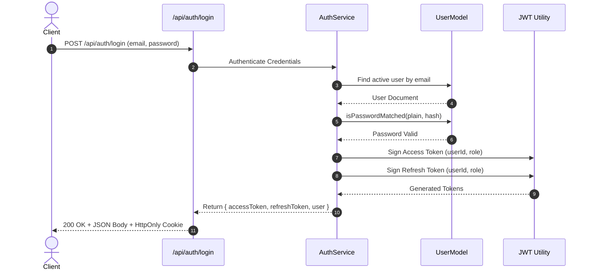

# Portfolio Platform - Authentication & Authorization Architecture

This document outlines the authentication, session lifecycle, role-based access control (RBAC), and security mechanisms implemented in the **Portfolio Platform**.

---

## 1. Authentication Overview

The system uses stateless **JSON Web Tokens (JWT)** paired with **Bcrypt** cryptographic password hashing:
- **Password Security**: Passwords are automatically hashed via Mongoose `pre('save')` hooks with configurable salt rounds (default: `12`). Plaintext passwords are never stored or returned in query responses.
- **Tokens**:
  - **Access Token**: Short-lived JWT (`JWT_ACCESS_EXPIRE_IN`, e.g., 1 day) used to authenticate API requests.
  - **Refresh Token**: Long-lived JWT (`JWT_REFRESH_EXPIRE_IN`, e.g., 30 days) stored securely to renew expired access tokens.

---

## 2. Roles & Permissions (RBAC)

The system supports two user roles defined in `user.constant.ts`:
- **`admin`**: Full administrative access to the backoffice dashboard to create, update, and delete projects, blogs, skills, qualifications, and review content.
- **`user`**: Registered user with permissions to submit reviews, update personal profile, and interact with authenticated features.

---

## 3. Token Lifecycle Sequence



---

## 4. Authentication Endpoints

| Method | Endpoint | Access | Description |
| :--- | :--- | :--- | :--- |
| `POST` | `/api/auth/login` | Public | Authenticates credentials and issues tokens |
| `POST` | `/api/user/create-user` | Public | Registers a new user account |
| `POST` | `/api/auth/refresh-token` | Public (Token) | Issues a new access token via valid refresh token |
| `POST` | `/api/auth/change-password` | Authenticated | Updates the password for current logged-in user |
| `POST` | `/api/auth/forgot-password` | Public | Generates password reset link and emails to user |
| `POST` | `/api/auth/reset-password` | Public (Reset Token)| Resets password using valid reset token |

---

## 5. Server Authorization Middleware (`auth.ts`)

The `auth(...requiredRoles)` middleware guards protected routes:
1. **Token Extraction**: Extracts the Bearer token from `req.headers.authorization`.
2. **Signature Verification**: Verifies token validity and expiration using `JWT_ACCESS_SECRET`.
3. **User Existence & Status Check**: Ensures the user exists in the database, has not been soft-deleted (`isDeleted: false`), and is not blocked (`status: 'active'`).
4. **Role Authorization**: Verifies that the decoded `role` matches at least one of the `requiredRoles`.
5. **Context Attachment**: Attaches the decoded user payload to `req.user` for downstream controller handlers.

```typescript
// Example route protection
router.post(
  '/create-project',
  auth('admin'),
  validateRequest(ProjectValidations.createProjectValidationSchema),
  ProjectControllers.createProject,
);
```

---

## 6. Client Route Protection

- **Redux Auth Slice (`authSlice.js`)**: Manages the logged-in user identity and token in client state, synchronized to persistent browser storage via `redux-persist`.
- **Protected Route Guard (`ProtectedRoute.jsx`)**: Higher-order component / route wrapper in Next.js that inspects the current user state and redirects unauthenticated visitors to `/login` with redirect retention.
