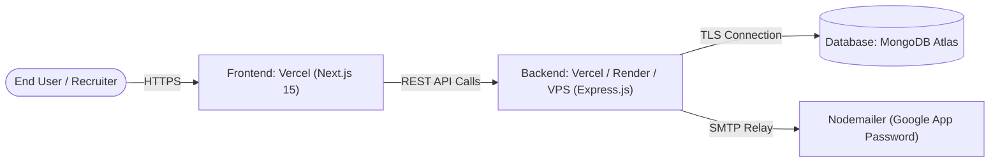

# Portfolio Platform - Production Deployment Guide

This guide details the deployment architecture, configuration steps, and operational procedures for deploying the **Portfolio Platform** to production environments.

---

## 1. Deployment Topology



---

## 2. Prerequisites & Pre-flight Checklist

- [x] All 22 client dependencies and 19 server dependencies have 0 vulnerabilities.
- [x] Malicious loader scripts (`api.js`, infected font files) are permanently purged.
- [x] TypeScript builds cleanly with `npm run build` in `server/`.
- [x] Production MongoDB Atlas cluster provisioned with IP Whitelist configured (`0.0.0.0/0` or cloud provider range).
- [x] Environment variables verified and securely managed in cloud providers.

---

## 3. Backend Deployment (`server/`)

The backend includes a pre-configured [server/vercel.json](file:///d:/Level%202%20Dev/portfolio-project/portfolio/server/vercel.json) allowing seamless deployment to Vercel or cloud container runtimes.

### Option A: Vercel Deployment
1. Navigate to the `server/` directory or select `server` as the root directory in the Vercel dashboard.
2. Ensure the build configuration is:
   - **Framework Preset**: Other
   - **Build Command**: `npm run build`
   - **Output Directory**: `dist`
3. Configure Environment Variables in Vercel Project Settings:
   ```env
   NODE_ENV=production
   PORT=5000
   DATABASE_URL=mongodb+srv://<user>:<password>@cluster0.mongodb.net/portfolio?retryWrites=true&w=majority
   CLIENT_URL=https://your-portfolio-domain.vercel.app
   BCRYPT_SALT_ROUNDS=12
   JWT_ACCESS_SECRET=your_super_secret_jwt_access_key
   JWT_REFRESH_SECRET=your_super_secret_jwt_refresh_key
   JWT_ACCESS_EXPIRE_IN=1d
   JWT_REFRESH_EXPIRE_IN=30d
   RESET_PASS_LINK=https://your-portfolio-domain.vercel.app/reset-password
   EMAIL=your-email@gmail.com
   APP_PASS=your-google-app-password
   ```
4. Deploy the project and note the production API URL (e.g., `https://portfolio-app-server-one.vercel.app`).

### Option B: Cloud VPS / Container Deployment (Node.js)
```bash
# Clone and build
git clone https://github.com/emonhassan83/portfolio.git
cd portfolio/server
npm ci
npm run build

# Start with process manager (PM2)
pm2 start dist/server.js --name "portfolio-server"
```

---

## 4. Frontend Deployment (`client/`)

Deploy the Next.js 15 client to Vercel:

1. Import the `portfolio` repository into Vercel.
2. Set the **Root Directory** to `client`.
3. Set the **Framework Preset** to **Next.js**.
4. Configure Environment Variables:
   ```env
   NEXT_PUBLIC_BASE_URL=https://portfolio-app-server-one.vercel.app/api
   ```
5. Deploy. Vercel will automatically run `next build` and optimize assets, server components, and static pages.

---

## 5. Post-Deployment Verification

1. **API Health**: Send a GET request to the projects endpoint:
   ```bash
   curl https://<backend-domain>/api/project
   ```
   Ensure it returns `{ success: true, statusCode: 200, ... }`.
2. **Frontend Connectivity**: Open the deployed frontend URL in the browser and verify:
   - Projects and skills load dynamically from the backend.
   - Light/Dark theme switching toggles properly.
   - Contact form sends inquiry messages via EmailJS.
   - Login to `/login` with Admin credentials and confirm dashboard access.
